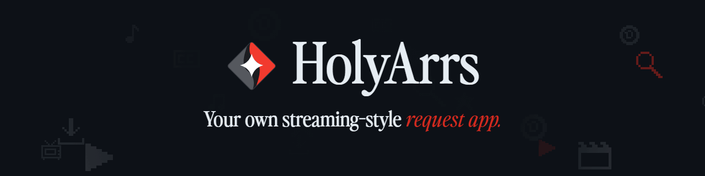
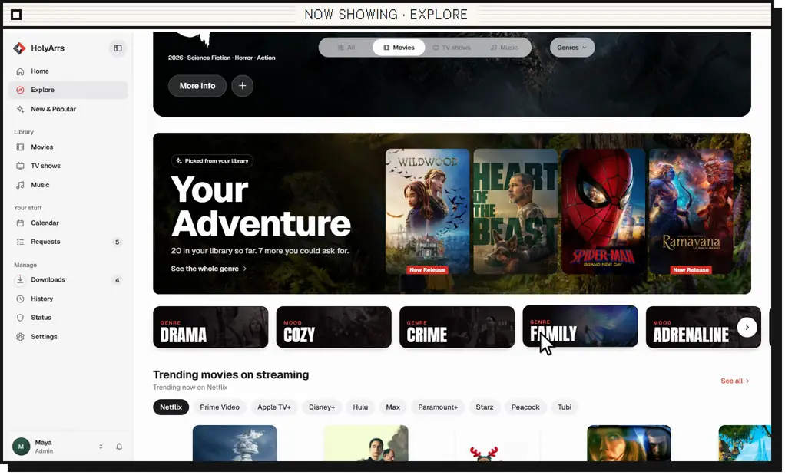
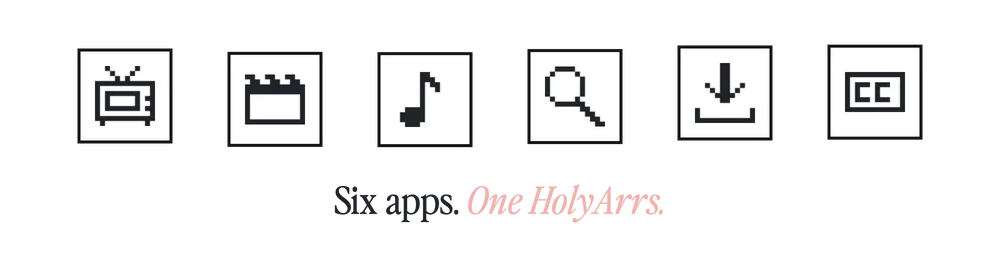
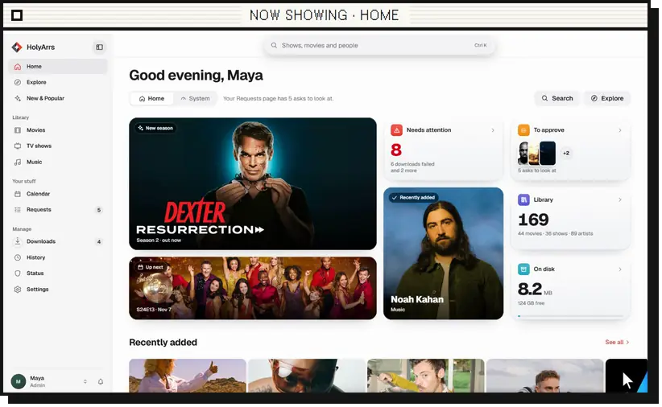
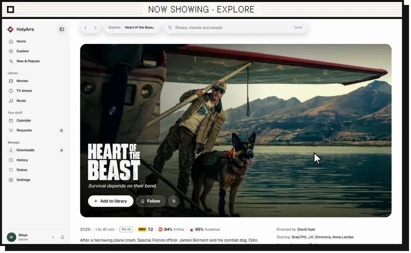
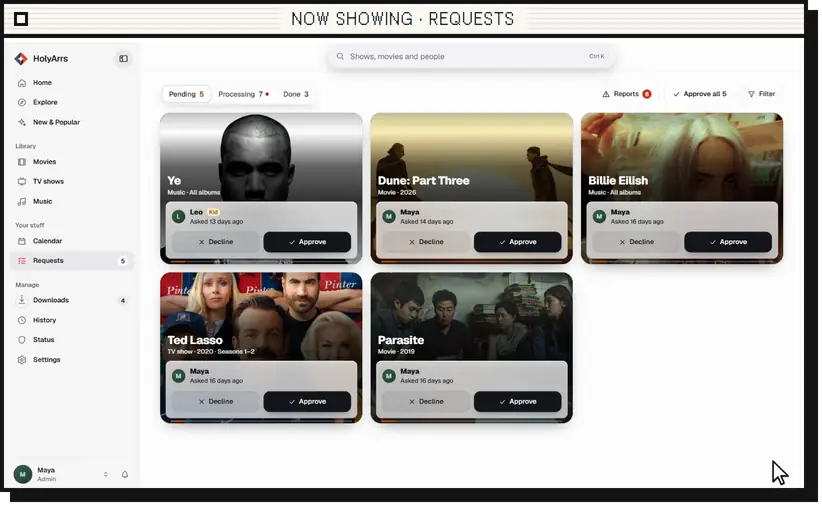
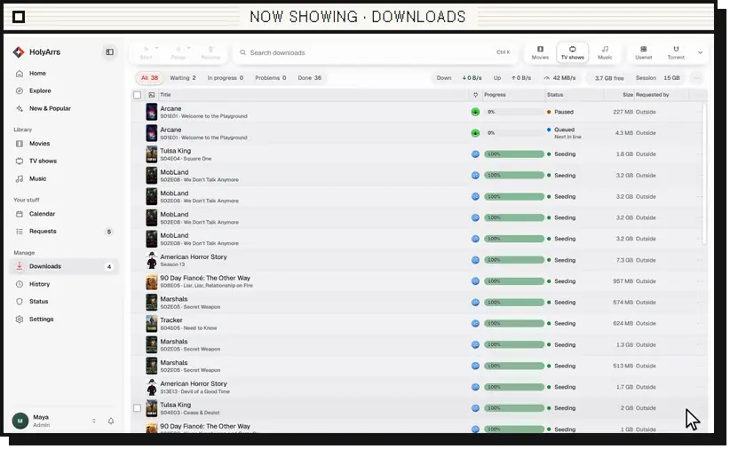
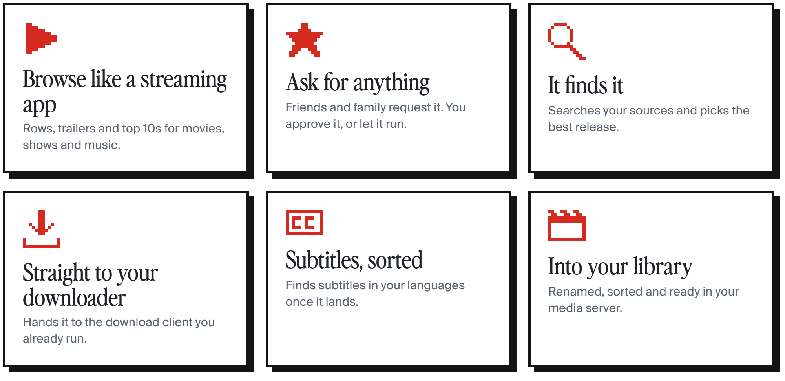

  <picture>
    <source media="(prefers-color-scheme: light)" srcset="https://raw.githubusercontent.com/HolyArrs/.github/main/profile/banner-light.gif">
    
  </picture>

<a href="https://holyarrs.com"><picture><source media="(prefers-color-scheme: dark)" srcset="https://raw.githubusercontent.com/HolyArrs/.github/main/profile/btn-site-dark.png"></picture></a>&nbsp;<a href="https://reddit.com/r/HolyArrs"><picture><source media="(prefers-color-scheme: dark)" srcset="https://raw.githubusercontent.com/HolyArrs/.github/main/profile/btn-reddit-dark.png"></picture></a>&nbsp;<a href="https://discord.com/invite/mthsvesKpC"><picture><source media="(prefers-color-scheme: dark)" srcset="https://raw.githubusercontent.com/HolyArrs/.github/main/profile/btn-discord-dark.png"></picture></a>&nbsp;<a href="https://holyarrs.com/roadmap/"><picture><source media="(prefers-color-scheme: dark)" srcset="https://raw.githubusercontent.com/HolyArrs/.github/main/profile/btn-roadmap-dark.png"></picture></a>&nbsp;<a href="https://holyarrs.com/whats-new/"><picture><source media="(prefers-color-scheme: dark)" srcset="https://raw.githubusercontent.com/HolyArrs/.github/main/profile/btn-news-dark.png"></picture></a>

<b>HolyArrs</b> is one self-hosted app for your shows, movies, music and downloads. Browse like a streaming app, ask for what you want, and it handles the rest.

  <picture><source media="(prefers-color-scheme: dark)" srcset="https://raw.githubusercontent.com/HolyArrs/.github/main/profile/hero-dark.webp"></picture>

  <picture><source media="(prefers-color-scheme: dark)" srcset="https://raw.githubusercontent.com/HolyArrs/.github/main/profile/six-dark.webp"></picture>

<picture><source media="(prefers-color-scheme: dark)" srcset="https://raw.githubusercontent.com/HolyArrs/.github/main/profile/h-tour-dark.png"></picture>

<table>
<tr>
<td width="50%" valign="top"><picture><source media="(prefers-color-scheme: dark)" srcset="https://raw.githubusercontent.com/HolyArrs/.github/main/profile/clip-home-dark.webp"></picture> <b>Home</b> · Everything waiting on you, at a glance.</td>
<td width="50%" valign="top"><picture><source media="(prefers-color-scheme: dark)" srcset="https://raw.githubusercontent.com/HolyArrs/.github/main/profile/clip-explore-dark.webp"></picture> <b>Title page</b> · Trailer, cast and one button to ask.</td>
</tr>
<tr>
<td width="50%" valign="top"><picture><source media="(prefers-color-scheme: dark)" srcset="https://raw.githubusercontent.com/HolyArrs/.github/main/profile/clip-requests-dark.webp"></picture> <b>Requests</b> · Approve what friends and family ask for.</td>
<td width="50%" valign="top"><picture><source media="(prefers-color-scheme: dark)" srcset="https://raw.githubusercontent.com/HolyArrs/.github/main/profile/clip-downloads-dark.webp"></picture> <b>Downloads</b> · Every grab, live, in one table.</td>
</tr>
</table>

<picture><source media="(prefers-color-scheme: dark)" srcset="https://raw.githubusercontent.com/HolyArrs/.github/main/profile/h-what-dark.png"></picture>

<picture><source media="(prefers-color-scheme: dark)" srcset="https://raw.githubusercontent.com/HolyArrs/.github/main/profile/tiles-dark.png"></picture>

<picture><source media="(prefers-color-scheme: dark)" srcset="https://raw.githubusercontent.com/HolyArrs/.github/main/profile/h-works-dark.png"></picture>

<picture><source media="(prefers-color-scheme: dark)" srcset="https://raw.githubusercontent.com/HolyArrs/.github/main/profile/works-dark.png"></picture>

<picture><source media="(prefers-color-scheme: dark)" srcset="https://raw.githubusercontent.com/HolyArrs/.github/main/profile/h-support-dark.png"></picture>

HolyArrs is free and open source, and it stays that way.

It isn't free to run, though. Every install talks to a metadata server I pay for every month, and every release gets tested before it ships. Sponsors cover that, and buy more hours for the things you vote for on the roadmap.

Can't sponsor? Join r/HolyArrs, vote on what gets built next, or show it to a friend who still runs six apps. That helps more than you'd think.

<a href="https://github.com/sponsors/CoderLuii"><picture><source media="(prefers-color-scheme: dark)" srcset="https://raw.githubusercontent.com/HolyArrs/.github/main/profile/btn-sponsor-dark.png"></picture></a>&nbsp;<a href="https://holyarrs.com/roadmap/"><picture><source media="(prefers-color-scheme: dark)" srcset="https://raw.githubusercontent.com/HolyArrs/.github/main/profile/btn-vote-dark.png"></picture></a>

